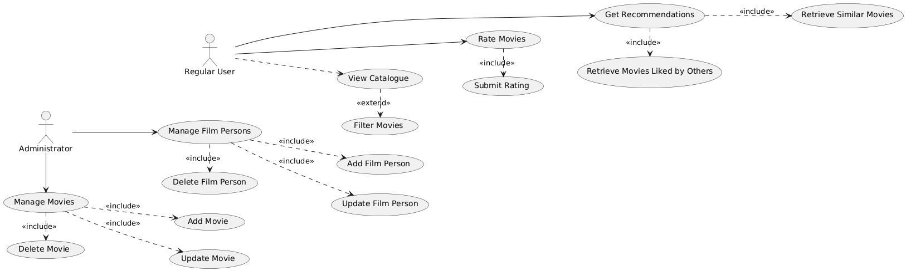
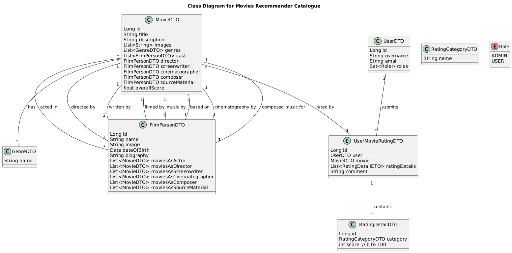

# Movies Recommender Catalogue

## Description
The web application is a catalogue of movies of different genres.
Each movie has a title, description, film director, and list of actors, and image(s) from the main playbill.
Each movie is categorized in one or more genres. 
Only the administrator can create, remove and update the list of movies. 
Users can rate the movies according to different criteria 
The main feature of the system is that users can pick one movie and get the list
of similar movies and movies that were liked the most by other users watching the same movie.

## Microservices Overview

This project follows a **microservices architecture**, where each service is responsible for a specific domain.

### 1. Movie Service 🎬
- **Purpose:** Manages movies, their details, and genres.
- **Key Features:**
  - CRUD operations for movies (add, update, delete, get)
  - Assign genres to movies
  - Retrieve movie details
  - Store movie-related images

### 2. Film Person Service 🎭
- **Purpose:** Handles information about film industry professionals (actors, directors, screenwriters, etc.).
- **Key Features:**
  - CRUD operations for film persons
  - Store biography, date of birth, and image
  - Link film persons to movies based on their roles (actor, director, etc.)

### 3. User Service 👤
- **Purpose:** Manages users, their roles, and authentication.
- **Key Features:**
  - User registration & login
  - Role-based access control (ADMIN, USER)
  - Manage user profiles (update email, username)

### 4. 📝 Feedback Service

  - **Purpose**: Handles both user ratings and written reviews for movies.

  - **Key Features**:
    - Users can rate movies (0–100%) in different categories (acting, directing, etc.)
    - Users can submit written reviews along with ratings
    - Retrieve all feedback (ratings + reviews) for a movie
    - Calculate an overall movie rating
    - Retrieve user-specific feedback
    - Allow administrators to moderate reviews

---

  - ### 5. 🎯 Recommendation Service

  - **Purpose**: Suggests similar movies or top-rated movies based on user preferences and feedback.

  - **Key Features**:
    - Recommend movies based on genre and user feedback

## Use case

## Class diagram

